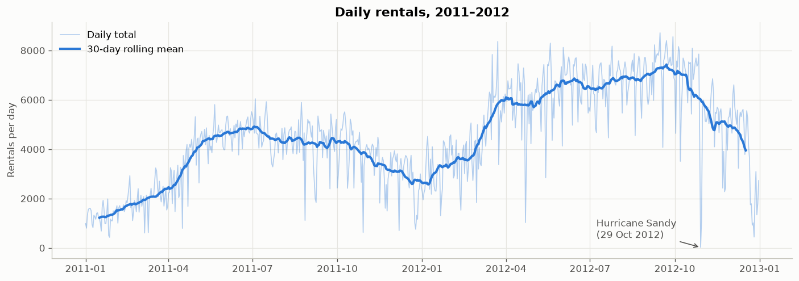
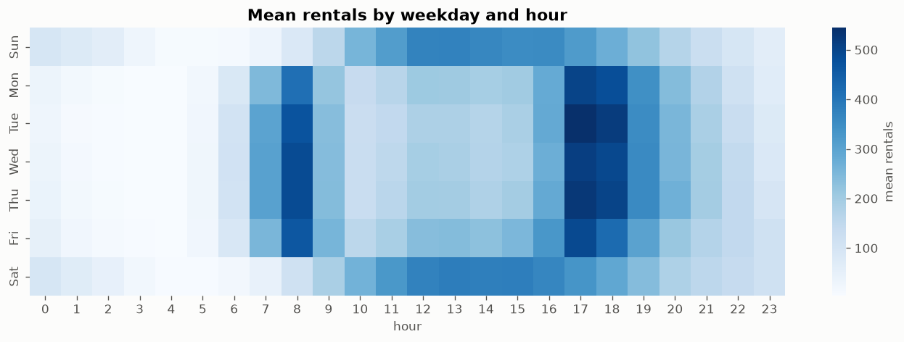
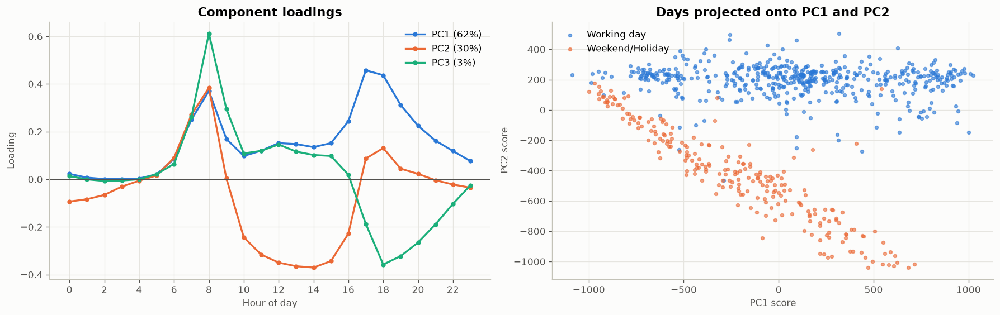
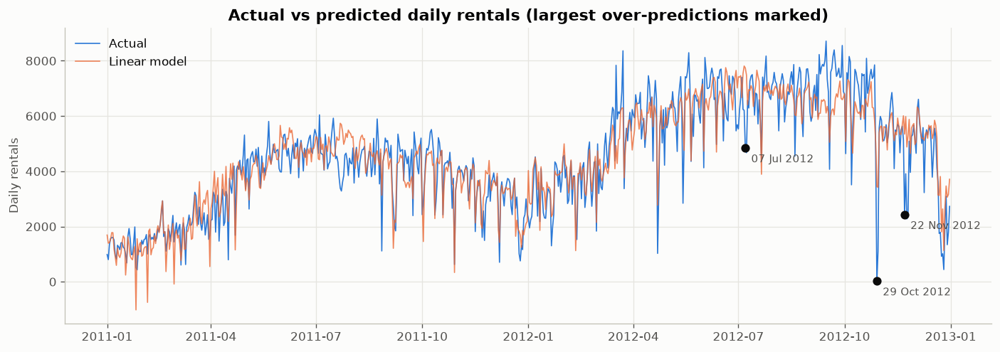

# 🚲 Bike Sharing Demand: Exploratory Data Analysis

An end-to-end Exploratory Data Analysis (EDA) project covering **Modules 2–7** of the EDA syllabus, from data cleaning to clustering, dimensionality reduction, regression and reinforcement learning. It uses two years of real bike-sharing data from Washington D.C.

**Main question:** *What drives bike-rental demand, and how can we describe, group and predict it?*

---

## 📊 Dataset

**UCI Bike Sharing Dataset**: hourly and daily rental counts from Capital Bikeshare (Washington D.C.) for 2011–2012, joined with weather and calendar information.

| File | Rows | Description |
|---|---|---|
| `data/raw/hour.csv` | 17,379 | Hourly rentals + weather (original) |
| `data/raw/day.csv` | 731 | Daily rentals + weather (original) |
| `data/raw/Readme.txt` | – | Original dataset documentation |
| `data/raw/rider_feedback.csv` | 60 | Small **illustrative** text corpus written for this project, used only for document clustering (the UCI data has no text) |
| `data/processed/hour_clean.csv` | 17,379 | Cleaned hourly data (output of notebook 01) |
| `data/processed/day_clean.csv` | 731 | Cleaned daily data (output of notebook 01) |

Key variables: `cnt` (total rentals), `casual` / `registered` users, `temp`, `atemp` (feels-like), `humidity`, `windspeed`, `season`, `weather`, `workingday`, `holiday`, `hour`.

> Source: Fanaee-T, H. & Gama, J. (2013). *Event labeling combining ensemble detectors and background knowledge.* Progress in Artificial Intelligence. [UCI Machine Learning Repository](https://archive.ics.uci.edu/dataset/275/bike+sharing+dataset)

---

## 📁 Project structure

```
bike-sharing-eda/
├── README.md
├── requirements.txt
├── data/
│   ├── raw/                  # original UCI files + feedback corpus
│   └── processed/            # cleaned data produced by notebook 01
├── notebooks/
│   ├── 01_data_transformation.ipynb          # Module 2
│   ├── 02_correlation_time_series.ipynb      # Module 3
│   ├── 03_summarization_visualization.ipynb  # Module 4
│   ├── 04_clustering.ipynb                   # Module 5
│   ├── 05_dimensionality_reduction.ipynb     # Module 6
│   └── 06_model_development.ipynb            # Module 7
├── src/
│   └── utils.py              # shared paths, plot style, data loaders
└── reports/
    └── figures/              # all charts saved by the notebooks
```

---

## 🗺️ Syllabus coverage

| Module | Notebook | Topics covered |
|---|---|---|
| **2 · Data Transformation** | [01](notebooks/01_data_transformation.ipynb) | Deduplication (exact & key-based) · replacing values (code→label, unit conversion, sentinel→NaN, rare-category merge) · discretization & binning (equal-width, equal-frequency, custom) · missing data (MCAR/MAR/MNAR, deletion, mean/median/group-mean, ffill/bfill, interpolation, compared to ground truth) · **Maximum Likelihood Estimation** (Normal: closed-form vs numerical; Poisson log-likelihood curve) |
| **3 · Correlation & Time Series** | [02](notebooks/02_correlation_time_series.ipynb) | Univariate · bivariate (Pearson, Spearman, ANOVA) · multivariate (correlation matrix, pair plot, heatmap) · TSA fundamentals & characteristics (trend, seasonality, stationarity, ADF test, ACF) · **time-based indexing** · visualizing (rolling mean, decomposition) · **grouping** · **resampling** (down- and up-sampling) |
| **4 · Summarization & Visualization** | [03](notebooks/03_summarization_visualization.ipynb) | Summary measures (central tendency, dispersion, shape) · data elaboration (derived features) · 1-D analysis (frequency tables, ECDF, Q-Q, Shapiro–Wilk) · 2-D analysis (covariance, hexbin) · **contingency tables** (χ², Cramér's V) · n-D analysis (multi-way pivots, facets) · **scatter plots, dot charts, bar plots** |
| **5 · Clustering** | [04](notebooks/04_clustering.ipynb) | **Spectral clustering** · **document clustering** (TF-IDF + LSA + K-means) · **MST clustering** · model-based clustering & **EM algorithm from scratch** · GMM with BIC · **hierarchical agglomerative** (Ward as model-based, dendrogram, linkage comparison) · **outlier detection** (GMM, K-means distance, DBSCAN) |
| **6 · Dimensionality Reduction** | [05](notebooks/05_dimensionality_reduction.ipynb) | **PCA** (from scratch + sklearn, scree, loadings) · **SVD** (link to PCA, low-rank reconstruction) · **Factor Analysis** (Bartlett test, varimax) · **intrinsic dimensionality** (variance threshold, Kaiser, Levina–Bickel MLE) · **MDS, Isomap, LLE, t-SNE** · **Self-Organizing Map** |
| **7 · Model Development** | [06](notebooks/06_model_development.ipynb) | Linear regression (from scratch → statsmodels OLS → sklearn) · VIF / multicollinearity · **evaluation** (MAE, RMSE, R², adj. R², MAPE, ±x% accuracy, cross-validation, residual diagnostics) · **understanding accuracy** · **supervised vs reinforcement learning** · **Q-learning bike-rebalancing demo** · **applications of RL** |

---

## 🔍 Key findings

**1. Demand has strong time patterns.** Rentals grew **~65% from 2011 to 2012**. They follow daily, weekly and yearly cycles and drop sharply on storm days such as Hurricane Sandy.



**2. Two kinds of days: commuting and leisure.** Working days show sharp 8 AM and 5–6 PM peaks. Weekends have one midday hump. Spectral clustering recovers this split from the hourly shapes alone (ARI = 0.93 vs the calendar).



**3. Weather matters, and temperature most of all.** Temperature correlates positively with demand (r ≈ 0.63 daily), humidity and wind negatively, and rain/snow cuts about 1,600 rides per day. `temp` and `atemp` are redundant (r ≈ 0.99).

**4. 24 hourly numbers reduce to about 2 dimensions.** PC1 (overall volume) and PC2 (commute vs leisure shape) explain **92%** of the variance in daily 24-hour profiles.



**5. Data-quality issues found by the analysis.** Wind readings of exactly 0 (12.5% of hours) were treated as sensor gaps. 165 hours are missing entirely. Outlier detection flagged a day with **0% humidity**, which is impossible, and Hurricane Irene.

**6. A simple linear model predicts daily demand well.** With weather, season, year and a `temp²` term it reaches **test R² ≈ 0.87**, with an **MAE of ≈ 540 rides/day (~12% of an average day)**, compared with ≈ 1,700 for a mean-only baseline.



**7. Reinforcement learning can rebalance a station.** A Q-learning agent trained on a station model built from the real demand profile cut riders turned away from **6.7 to 0.6 per day** compared with never rebalancing.

---

## ▶️ How to run

```bash
# 1. Clone and enter the project
git clone https://github.com/aryannn15/bike-sharing-eda.git
cd bike-sharing-eda

# 2. Create a virtual environment and install dependencies
python3 -m venv .venv
source .venv/bin/activate          # Windows: .venv\Scripts\activate
pip install -r requirements.txt

# 3. Open the notebooks
jupyter notebook notebooks/
```

Run the notebooks **in order (01 → 06)**: notebook 01 creates the cleaned files in `data/processed/` that the others read. All notebooks are committed **with their outputs**, so you can read them directly on GitHub without running anything.

To re-execute everything from the command line:

```bash
cd notebooks
for nb in 0*.ipynb; do jupyter nbconvert --to notebook --execute --inplace "$nb"; done
```

---

## 📝 Notes

- **Simulated data-quality issues (notebook 01 only).** The UCI file is already clean. To practise deduplication and imputation, notebook 01 injects 150 duplicate rows and blanks 5% of `temp`/`humidity` values with a fixed random seed. Because the true values are known, each imputation method can be scored. The wind-speed zeros and missing hours are **real** issues in the data.
- **Feedback corpus.** `rider_feedback.csv` is a small set of example comments written for this project to demonstrate document clustering. It is not real customer data.
- **RL environment.** The Q-learning station simulator is a teaching model: hourly demand follows the real average working-day profile, scaled to one station, with assumed pick-up/return shares.

## 🛠️ Tech stack

Python · pandas · NumPy · Matplotlib · seaborn · SciPy · scikit-learn · statsmodels · MiniSom · Jupyter
